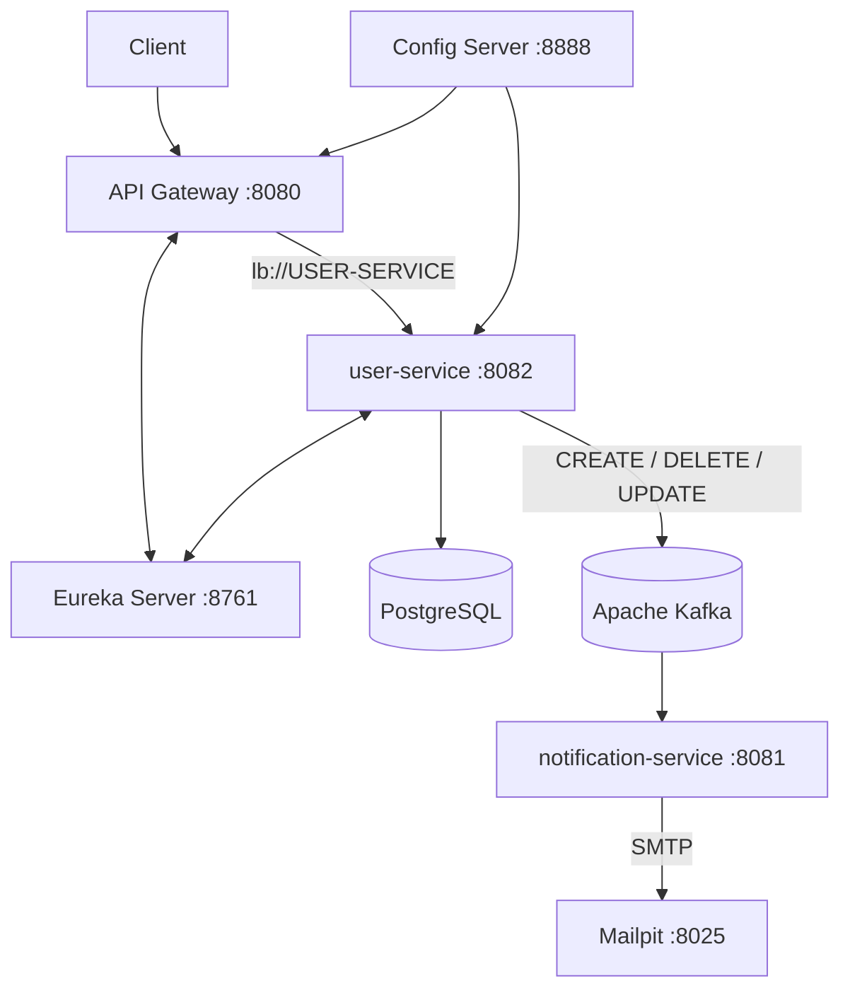

# Microservices — Docker Compose Deployment

Микросервисная система для управления пользователями и отправки email-уведомлений. Проект разворачивается в контейнерной среде с использованием Docker Compose.

В рамках DevOps реализовано совместное развёртывание инфраструктуры и микросервисов, централизованное управление конфигурацией, обнаружение сервисов и взаимодействие приложений через Apache Kafka.

## Содержание

- [Архитектура системы](#архитектура-системы)
- [Технологии](#технологии)
- [Структура проекта](#структура-проекта)
- [Компоненты системы](#компоненты-системы)
- [Сетевая конфигурация](#сетевая-конфигурация)
- [Подготовка к запуску](#подготовка-к-запуску)
- [Запуск системы](#запуск-системы)
- [Проверка работоспособности](#проверка-работоспособности)
- [Остановка системы](#остановка-системы)

## Архитектура системы

Система состоит из восьми сервисов, объединённых общей Docker-сетью:

1. PostgreSQL — хранение данных пользователей.
2. Apache Kafka — обмен событиями между микросервисами.
3. Mailpit — тестовый почтовый сервер.
4. Eureka Server — обнаружение и регистрация сервисов.
5. Config Server — централизованное управление конфигурацией.
6. API Gateway — единая точка входа для клиентских запросов.
7. user-service — управление пользователями.
8. notification-service — обработка событий и отправка email-уведомлений.

### Схема взаимодействия



### Сценарий взаимодействия микросервисов

При создании пользователя:

1. Клиент отправляет POST-запрос через API Gateway.
2. API Gateway находит user-service через Eureka.
3. user-service сохраняет пользователя в PostgreSQL.
4. user-service публикует событие CREATE в Kafka.
5. notification-service получает событие из топика `user-events`.
6. notification-service отправляет email через SMTP в Mailpit.

При удалении пользователя аналогично публикуется событие DELETE и отправляется уведомление.

## Технологии

| Технология | Назначение |
|---|---|
| Java 21 | Язык разработки |
| Spring Boot | Разработка микросервисов |
| Spring Cloud Gateway | API Gateway |
| Spring Cloud Netflix Eureka | Service Discovery |
| Spring Cloud Config | External Configuration |
| Spring Data JPA | Работа с базой данных |
| PostgreSQL 16 | Реляционная база данных |
| Apache Kafka 4.3.1 | Обмен событиями |
| Mailpit | Тестирование email-уведомлений |
| Docker | Контейнеризация приложений |
| Docker Compose | Оркестрация контейнеров |
| Maven | Сборка Java-приложений |

## Структура проекта

Для сборки всех приложений через Docker Compose репозитории должны располагаться рядом:

```text
HomeWork2/
├── user-service/
│   ├── api-gateway/
│   │   ├── Dockerfile
│   │   └── pom.xml
│   │
│   ├── config-server/
│   │   ├── config-repo/
│   │   │   ├── api-gateway.properties
│   │   │   ├── api-gateway-docker.properties
│   │   │   ├── user-service.properties
│   │   │   └── user-service-docker.properties
│   │   ├── Dockerfile
│   │   └── pom.xml
│   │
│   ├── eureka-server/
│   │   ├── Dockerfile
│   │   └── pom.xml
│   │
│   ├── src/
│   ├── Dockerfile
│   ├── docker-compose.yml
│   ├── .env.example
│   ├── .gitignore
│   ├── pom.xml
│   └── README.md
│
└── notification-service/
    ├── src/
    ├── Dockerfile
    ├── pom.xml
    └── README.md
```

`notification-service` является отдельным проектом. Docker Compose использует соседний каталог `../notification-service` в качестве контекста сборки.

## Компоненты системы

### 1. PostgreSQL

Используется для хранения данных пользователей.

Основные параметры:

- Image: `postgres:16`
- База данных: `user_service`
- Пользователь: `user_service_user`
- Порт контейнера: `5432`
- Порт хоста: `5433`

Данные сохраняются в постоянном Docker Volume:

`postgres_data`

Для проверки готовности используется `pg_isready`.

### 2. Apache Kafka

Используется для асинхронного обмена событиями между микросервисами.

Основные параметры:

- Image: `apache/kafka:4.3.1`
- Режим работы: KRaft
- Внутренний адрес: `kafka:19092`
- Внешний адрес: `localhost:9092`
- Топик событий: `user-events`

Для хранения данных используется постоянный Docker Volume:

`kafka_data`

Kafka работает с отдельными listener-ами для внутреннего и внешнего подключений.

### 3. Eureka Server — Service Discovery

Реализует централизованный реестр микросервисов.

Основные функции:

- Регистрация экземпляров приложений.
- Хранение адресов и портов сервисов.
- Предоставление реестра зарегистрированных приложений.
- Поддержка обнаружения сервисов через Eureka Client.

После запуска в Eureka регистрируются:

- `USER-SERVICE`
- `API-GATEWAY`

Адрес интерфейса:

http://localhost:8761

### 4. Config Server — External Configuration

Используется для централизованного управления конфигурациями приложений.

Основные параметры:

- Активный профиль: `native`.
- Порт: `8888`.
- Хранилище конфигураций: `config-server/config-repo/`.

Для Docker-окружения используются отдельные профили:

- `user-service-docker.properties`
- `api-gateway-docker.properties`

Конфигурационные файлы доступны приложениям через Spring Cloud Config Client.

Проверка получения конфигурации:

```bash
curl http://localhost:8888/user-service/docker
curl http://localhost:8888/api-gateway/docker
```

### 5. API Gateway

Используется в качестве единой точки входа для клиентских запросов.

Основные параметры:

- Порт: `8080`.
- Регистрация в Eureka: включена.
- Получение реестра сервисов: включено.

Настроена маршрутизация запросов к user-service:

```properties
spring.cloud.gateway.server.webflux.routes[0].id=user-service
spring.cloud.gateway.server.webflux.routes[0].uri=lb://USER-SERVICE
spring.cloud.gateway.server.webflux.routes[0].predicates[0]=Path=/api/users/**
```

`lb://USER-SERVICE` позволяет Gateway находить экземпляр микросервиса через Eureka и Spring Cloud LoadBalancer.

Клиентские запросы направляются через:

`http://localhost:8080/api/users`

### 6. user-service

Основной микросервис для управления пользователями.

Основные функции:

- Создание пользователей.
- Получение пользователя по ID.
- Получение списка пользователей.
- Обновление данных.
- Удаление пользователей.
- Сохранение данных в PostgreSQL.
- Публикация событий в Kafka.
- Регистрация в Eureka.
- Получение конфигурации из Config Server.

Порт: `8082`.

При создании, обновлении и удалении пользователя публикуются соответствующие события в Kafka.

### 7. notification-service

Отдельный микросервис для обработки пользовательских событий и отправки email-уведомлений.

Основные функции:

- Подключение к Kafka.
- Подписка на топик `user-events`.
- Обработка событий CREATE и DELETE.
- Отправка email через SMTP.
- Обработка события UPDATE без отправки уведомления.

Параметры Docker-профиля:

```properties
spring.kafka.bootstrap-servers=kafka:19092

spring.mail.host=mailpit
spring.mail.port=1025
```

Порт приложения: `8081`.

### 8. Mailpit

Используется для локального тестирования отправки электронной почты.

Параметры:

- SMTP: `1025`
- Web UI: `8025`

Веб-интерфейс:

http://localhost:8025

Письма не отправляются реальным получателям, а сохраняются в интерфейсе Mailpit для проверки.

## Сетевая конфигурация

Все сервисы подключены к общей Docker-сети:

`app-network`

Внутри Docker-контейнеров приложения взаимодействуют по именам сервисов, а не через `localhost`.

| Компонент | Адрес внутри Docker |
|---|---|
| PostgreSQL | `postgres:5432` |
| Kafka | `kafka:19092` |
| Eureka Server | `http://eureka-server:8761/eureka/` |
| Config Server | `http://config-server:8888` |
| API Gateway | `http://api-gateway:8080` |
| user-service | `http://user-service:8082` |
| notification-service | `http://notification-service:8081` |
| Mailpit SMTP | `mailpit:1025` |

### Порты на хостовой машине

| Сервис | Порт |
|---|---:|
| API Gateway | 8080 |
| notification-service | 8081 |
| user-service | 8082 |
| PostgreSQL | 5433 |
| Kafka | 9092 |
| Eureka Server | 8761 |
| Config Server | 8888 |
| Mailpit SMTP | 1025 |
| Mailpit Web UI | 8025 |

### Постоянное хранение данных

Для PostgreSQL и Kafka настроены Docker Volumes:

- `postgres_data`
- `kafka_data`

Данные сохраняются при остановке и пересоздании контейнеров.

## Подготовка к запуску

### Требования

Перед запуском необходимо установить:

- Docker Desktop.
- Docker Compose.

### Подготовка каталогов

Необходимо расположить репозитории `user-service` и `notification-service` рядом друг с другом, поскольку Docker Compose использует относительный путь `../notification-service`.

### Настройка переменных окружения

В корневом каталоге `user-service` находится шаблон `.env.example`.

Создать локальный файл окружения:

```bash
cp .env.example .env
```

Открыть `.env` и указать собственный пароль:

```dotenv
DB_PASSWORD=your_secure_password
```

Файл `.env` используется Docker Compose для передачи переменных окружения контейнерам.

**Важно:** файл `.env` содержит секретные данные и не должен добавляться в Git. Для этого он исключён через `.gitignore`.

## Запуск системы

Все команды необходимо выполнять из корневого каталога `user-service`, где расположен `docker-compose.yml`.

### 1. Проверка конфигурации

```bash
docker compose config --quiet
```

Команда проверяет корректность Docker Compose без запуска контейнеров.

### 2. Сборка и запуск всех сервисов

```bash
docker compose up --build -d
```

Параметры:

- `up` — создание и запуск сервисов.
- `--build` — сборка Docker-образов приложений.
- `-d` — запуск контейнеров в фоновом режиме.

Docker Compose автоматически создаёт сеть, необходимые тома и запускает все восемь сервисов.

### 3. Проверка состояния контейнеров

```bash
docker compose ps
```

PostgreSQL и Kafka должны получить статус `healthy`. Остальные приложения должны находиться в состоянии `Up`.

Для просмотра логов:

```bash
docker compose logs --tail=100
```

Логи отдельных компонентов:

```bash
docker compose logs --tail=100 user-service
docker compose logs --tail=100 notification-service
docker compose logs --tail=100 api-gateway
docker compose logs --tail=100 config-server
docker compose logs --tail=100 eureka-server
```

После первого запуска необходимо дождаться полной инициализации Spring Boot приложений и регистрации сервисов в Eureka.

## Проверка работоспособности

### 1. Проверка Eureka

Получение списка зарегистрированных сервисов:

```bash
curl -H "Accept: application/json" \
http://localhost:8761/eureka/apps
```

В реестре должны присутствовать:

- `USER-SERVICE`
- `API-GATEWAY`

Оба сервиса должны иметь статус `UP`.

### 2. Проверка Config Server

Получение конфигурации user-service:

```bash
curl http://localhost:8888/user-service/docker
```

Получение конфигурации API Gateway:

```bash
curl http://localhost:8888/api-gateway/docker
```

Ожидаемый результат — HTTP 200 и JSON с соответствующими настройками приложений.

### 3. Проверка API Gateway

Получение списка пользователей:

```bash
curl -i http://localhost:8080/api/users
```

Получение пользователя по ID:

```bash
curl -i http://localhost:8080/api/users/1
```

### 4. Проверка создания пользователя

```bash
curl -i -X POST http://localhost:8080/api/users \
  -H "Content-Type: application/json" \
  -d '{
    "name": "Docker Test",
    "email": "docker.test@example.com",
    "age": 29
  }'
```

Ожидаемый HTTP-статус:

`201 Created`

В ответе возвращаются данные пользователя и HATEOAS-ссылки.

### 5. Проверка Kafka и email-уведомлений

После создания пользователя user-service публикует событие CREATE в топик `user-events`.

notification-service получает событие и отправляет email.

Проверка логов:

```bash
docker compose logs --since=5m notification-service
```

Ожидаемые сообщения:

```text
Получено событие из Kafka
Операция: CREATE
Email: docker.test@example.com
```

Проверить полученное письмо можно через Mailpit:

http://localhost:8025

Тема письма:

`Аккаунт успешно создан`

### 6. Проверка удаления пользователя

Для удаления используется ID, полученный в ответе на создание пользователя:

```bash
curl -i -X DELETE http://localhost:8080/api/users/1
```

Ожидаемый HTTP-статус:

`204 No Content`

После удаления user-service отправляет событие DELETE в Kafka.

Проверка обработки:

```bash
docker compose logs --since=5m notification-service
```

Ожидаемые сообщения:

```text
Получено событие из Kafka
Операция: DELETE
Email: docker.test@example.com
```

В Mailpit должно появиться письмо с темой:

`Аккаунт удалён`

**Примечание:** в командах проверки необходимо использовать ID реально созданного пользователя и уникальный email.

## Swagger / OpenAPI

Документация REST API доступна через Swagger UI:

http://localhost:8082/swagger-ui.html

OpenAPI JSON:

http://localhost:8082/v3/api-docs

## Остановка системы

Для остановки и удаления контейнеров и сети проекта:

```bash
docker compose down
```

Постоянные тома PostgreSQL и Kafka при этом сохраняются.

Для повторного запуска:

```bash
docker compose up --build -d
```

**Внимание:** команда ниже удаляет также постоянные тома с данными PostgreSQL и Kafka:

```bash
docker compose down -v
```

Использовать её следует только при необходимости полного сброса данных.

---

## Итог

В результате развёртывания Docker Compose обеспечивает совместную работу инфраструктурных компонентов и микросервисов:

- единый запуск всех компонентов системы;
- централизованное управление конфигурацией через Spring Cloud Config;
- обнаружение сервисов через Eureka;
- маршрутизацию запросов через API Gateway;
- хранение пользовательских данных в PostgreSQL;
- асинхронный обмен событиями через Apache Kafka;
- обработку событий и отправку email-уведомлений через notification-service;
- тестирование отправки писем с помощью Mailpit.

Таким образом, микросервисная система разворачивается в контейнерной среде и поддерживает взаимодействие между всеми необходимыми компонентами.
