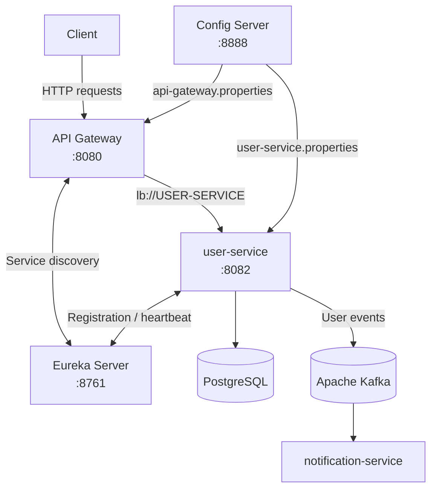

# User Service — Microservices Patterns

Микросервисное приложение для управления пользователями, публикации событий в Apache Kafka и взаимодействия с другими сервисами.

В рамках ДЗ 7 существующая система расширена паттернами микросервисной архитектуры с использованием Spring Cloud:

- API Gateway
- Service Discovery
- External Configuration
- Circuit Breaker

## Технологии

- Java 21
- Spring Boot 4.1.2
- Spring Cloud 2025.1.4
- Spring Web
- Spring WebFlux
- Spring Data JPA
- Spring HATEOAS
- Springdoc OpenAPI (Swagger UI)
- Spring Cloud Gateway
- Spring Cloud Netflix Eureka
- Spring Cloud Config
- Spring Cloud Circuit Breaker
- Resilience4j
- Spring Boot Actuator
- PostgreSQL
- Apache Kafka
- Maven
- JUnit и Mockito

## Структура проекта

```text
user-service/
├── api-gateway/
│   ├── src/
│   │   └── main/
│   │       ├── java/
│   │       └── resources/
│   │           └── application.properties
│   └── pom.xml
│
├── config-server/
│   ├── config-repo/
│   │   ├── user-service.properties
│   │   └── api-gateway.properties
│   ├── src/
│   │   └── main/
│   │       ├── java/
│   │       └── resources/
│   │           └── application.properties
│   └── pom.xml
│
├── eureka-server/
│   ├── src/
│   │   └── main/
│   │       ├── java/
│   │       └── resources/
│   │           └── application.properties
│   └── pom.xml
│
├── src/
│   └── main/
│       ├── java/
│       └── resources/
│           └── application.properties
│
├── pom.xml
└── README.md
```

## Архитектура приложения

Система состоит из четырёх Spring Boot-приложений:

1. **Eureka Server** — реестр микросервисов.
2. **Config Server** — централизованное хранилище конфигурации.
3. **API Gateway** — единая точка входа для клиентских запросов.
4. **user-service** — основной сервис управления пользователями.

Дополнительно используются PostgreSQL и Apache Kafka.

### Схема взаимодействия



## 1. Service Discovery — Eureka

Для обнаружения микросервисов используется Spring Cloud Netflix Eureka.

Создано отдельное приложение `eureka-server`, выполняющее роль реестра сервисов.

После запуска приложения регистрируются в Eureka:

- `USER-SERVICE`
- `API-GATEWAY`

Eureka хранит информацию о зарегистрированных экземплярах: имя приложения, IP-адрес, порт и состояние доступности.

**Основные настройки:**

- Адрес: `http://localhost:8761`
- Порт: `8761`
- Регистрация и получение реестра для Eureka Server отключены.

Для локального окружения `user-service` использует IP-адрес `127.0.0.1` при регистрации в Eureka.

**Проверка:**

Eureka Dashboard:

http://localhost:8761

Получение зарегистрированных сервисов:

```bash
curl -H "Accept: application/json" \
http://localhost:8761/eureka/apps
```

Получение информации о `USER-SERVICE`:

```bash
curl -H "Accept: application/json" \
http://localhost:8761/eureka/apps/USER-SERVICE
```

## 2. External Configuration — Spring Cloud Config

Для централизованного управления настройками используется Spring Cloud Config.

Создано отдельное приложение `config-server`, которое предоставляет конфигурацию другим приложениям.

В качестве хранилища используется Native Profile — конфигурационные файлы располагаются в файловой системе.

**Основные настройки:**

- Адрес Config Server: `http://localhost:8888`
- Порт: `8888`
- Активный профиль: `native`
- Каталог конфигурации: `config-server/config-repo/`

Внешние конфигурационные файлы:

| Файл | Приложение |
|---|---|
| `user-service.properties` | user-service |
| `api-gateway.properties` | API Gateway |

Для получения внешних настроек приложения используют Spring Cloud Config Client.

Локальный `application.properties` содержит имя приложения и адрес Config Server.

Пример:

```properties
spring.application.name=user-service
spring.config.import=optional:configserver:http://localhost:8888
```

**Проверка:**

Получение конфигурации user-service:

```bash
curl http://localhost:8888/user-service/default
```

Получение конфигурации API Gateway:

```bash
curl http://localhost:8888/api-gateway/default
```

## 3. API Gateway — Spring Cloud Gateway

Для организации единой точки входа используется Spring Cloud Gateway Server WebFlux.

API Gateway принимает HTTP-запросы от клиентов и маршрутизирует их в соответствующие микросервисы.

**Основные настройки:**

- Адрес: `http://localhost:8080`
- Порт: `8080`
- Регистрация в Eureka: включена.
- Получение реестра сервисов: включено.

Настроен маршрут для `user-service`.

```properties
spring.cloud.gateway.server.webflux.routes[0].id=user-service

spring.cloud.gateway.server.webflux.routes[0].uri=lb://USER-SERVICE

spring.cloud.gateway.server.webflux.routes[0].predicates[0]=Path=/api/users/**
```

`lb://USER-SERVICE` означает, что Gateway получает адрес экземпляра сервиса через Eureka и LoadBalancer.

Все запросы, соответствующие `/api/users/**`, перенаправляются в `user-service`.

**Пример:**

```text
Клиент:
GET http://localhost:8080/api/users

API Gateway:
8080 → Eureka → USER-SERVICE:8082

Результат:
HTTP 200 OK
```

## 4. Circuit Breaker — Resilience4j

Для защиты от отказов зависимых сервисов используется Spring Cloud Circuit Breaker с реализацией Resilience4j.

Circuit Breaker отслеживает ошибки при обращении Gateway к `user-service` и ограничивает запросы к недоступному сервису.

Используется экземпляр:

`userServiceCircuitBreaker`

### Настройки Circuit Breaker

| Параметр | Значение | Описание |
|---|---|---|
| Sliding window type | COUNT_BASED | Окно на основе количества запросов |
| Sliding window size | 5 | Размер окна — 5 запросов |
| Minimum number of calls | 5 | Минимальное количество запросов для расчёта ошибок |
| Failure rate threshold | 50% | Порог срабатывания |
| Wait duration in open state | 10s | Время нахождения в OPEN |
| Permitted calls in half-open state | 2 | Количество проверочных запросов |

### Состояния Circuit Breaker

- **CLOSED** — запросы проходят в целевой сервис, ошибки отслеживаются.
- **OPEN** — обращения к недоступному сервису блокируются, выполняется переход к Fallback.
- **HALF_OPEN** — разрешается ограниченное количество проверочных запросов для определения доступности сервиса.

При успешном восстановлении целевого сервиса Circuit Breaker возвращается в CLOSED.

### Fallback

В API Gateway создан `FallbackController`, который обрабатывает запросы по адресу `/fallback`.

При недоступности `user-service` возвращается HTTP 503 Service Unavailable.

Пример ответа:

```json
{
  "error": "USER_SERVICE_UNAVAILABLE",
  "message": "Сервис пользователей временно недоступен. Попробуйте позже."
}
```

### Мониторинг Circuit Breaker

Для мониторинга используется Spring Boot Actuator и Resilience4j Micrometer.

Открытые endpoints:

| Endpoint | Назначение |
|---|---|
| `/actuator/health` | Проверка состояния приложения |
| `/actuator/info` | Информация о приложении |
| `/actuator/metrics` | Список доступных метрик |

Основные метрики Resilience4j:

- `resilience4j.circuitbreaker.calls`
- `resilience4j.circuitbreaker.state`
- `resilience4j.circuitbreaker.failure.rate`
- `resilience4j.circuitbreaker.not.permitted.calls`

Проверка состояния CLOSED:

```bash
curl -G http://localhost:8080/actuator/metrics/resilience4j.circuitbreaker.state \
  --data-urlencode "tag=name:userServiceCircuitBreaker" \
  --data-urlencode "tag=state:closed"
```

Аналогично можно проверить состояния OPEN и HALF_OPEN.

## REST API

REST API реализован в `UserController`.

| HTTP-метод | Endpoint | Описание |
|---|---|---|
| GET | `/api/users` | Получение списка пользователей |
| GET | `/api/users/{id}` | Получение пользователя по ID |
| POST | `/api/users` | Создание пользователя |
| PUT | `/api/users/{id}` | Обновление пользователя |
| DELETE | `/api/users/{id}` | Удаление пользователя |

Внешний адрес API через Gateway:

`http://localhost:8080/api/users`

## Swagger / OpenAPI

Для изучения и тестирования REST API используется Swagger UI.

После запуска `user-service` документация доступна по адресам:

- Swagger UI: http://localhost:8082/swagger-ui.html
- OpenAPI JSON: http://localhost:8082/v3/api-docs

## HATEOAS

API возвращает ссылки для навигации между ресурсами в формате HAL.

Основные ссылки:

- `self` — ссылка на текущий ресурс пользователя.
- `users` — ссылка на коллекцию пользователей.

При получении списка пользователей в `_embedded` содержится коллекция пользователей, у каждого из которых есть ссылка `self`.

При создании, получении и обновлении пользователя ответ содержит ссылки для навигации. Удаление пользователя возвращает статус `204 No Content` без тела ответа.

В текущей локальной конфигурации HATEOAS-ссылки формируются на адрес `user-service` (`127.0.0.1:8082`).

## Взаимодействие с Kafka

События публикуются в топик `user-events`.

При создании пользователя отправляется событие с операцией `CREATE`, при удалении — с операцией `DELETE`.

Пример события:

```json
{
  "operation": "CREATE",
  "email": "user@example.com"
}
```

Эти события обрабатывает отдельный микросервис `notification-service`, который отправляет email-уведомления пользователям.

Локальные настройки Kafka:

- Адрес брокера: `localhost:9092`
- Топик событий: `user-events`

## Запуск проекта

Для локального запуска необходимо:

- Java 21
- Maven
- PostgreSQL
- Apache Kafka

PostgreSQL должен быть доступен на порту `5432`. Необходима база данных `user_service` и пользователь `user_service_user`.

Пароль базы данных передаётся через переменную окружения `DB_PASSWORD`. Не следует записывать реальный пароль в конфигурационные файлы или Git.

Для Fish Shell перед запуском `user-service` можно задать переменную:

```bash
set -x DB_PASSWORD 'your_database_password'
```

Замените значение на пароль локальной учётной записи PostgreSQL. В IntelliJ IDEA также можно задать эту переменную в Run Configuration.

### Порядок запуска приложений

Каждое приложение запускается в отдельном терминале.

**1. Eureka Server**

```bash
cd eureka-server
mvn spring-boot:run
```

После запуска доступен на `http://localhost:8761`.

**2. Config Server**

```bash
cd config-server
mvn spring-boot:run
```

Важно запускать команду из каталога `config-server`, так как Native Profile использует относительный путь `file:./config-repo/`.

После запуска доступен на `http://localhost:8888`.

**3. user-service**

В корне проекта:

```bash
mvn spring-boot:run
```

Перед запуском должна быть установлена переменная окружения `DB_PASSWORD`, а PostgreSQL и Kafka должны быть доступны.

После запуска доступен на `http://localhost:8082`.

**4. API Gateway**

В корне проекта:

```bash
mvn -f api-gateway/pom.xml spring-boot:run
```

После запуска доступен на `http://localhost:8080`.

### Проверка работоспособности

Проверка API через Gateway:

```bash
curl -i http://localhost:8080/api/users
```

Проверка получения конкретного пользователя:

```bash
curl -i http://localhost:8080/api/users/3
```

Проверка регистрации сервисов в Eureka:

```bash
curl -H "Accept: application/json" \
http://localhost:8761/eureka/apps
```

Проверка получения внешней конфигурации:

```bash
curl http://localhost:8888/user-service/default
```

### Проверка Circuit Breaker

1. Убедиться, что все приложения запущены.
2. Остановить `user-service`.
3. Отправить несколько запросов через API Gateway:
